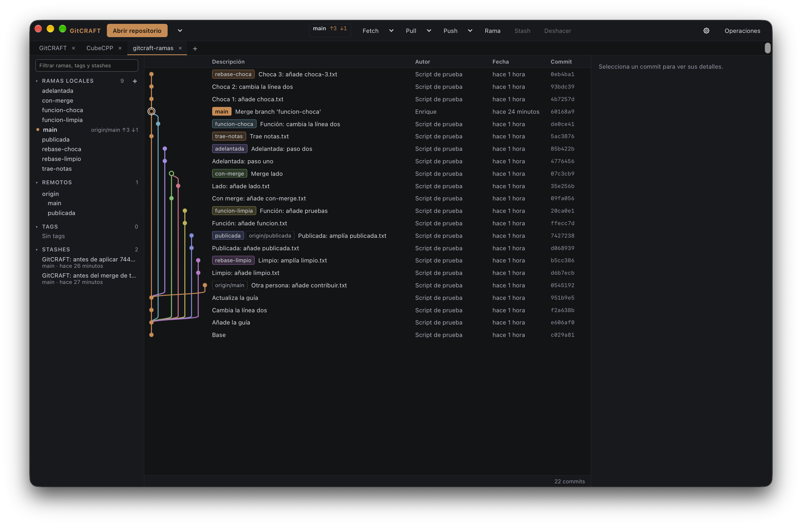
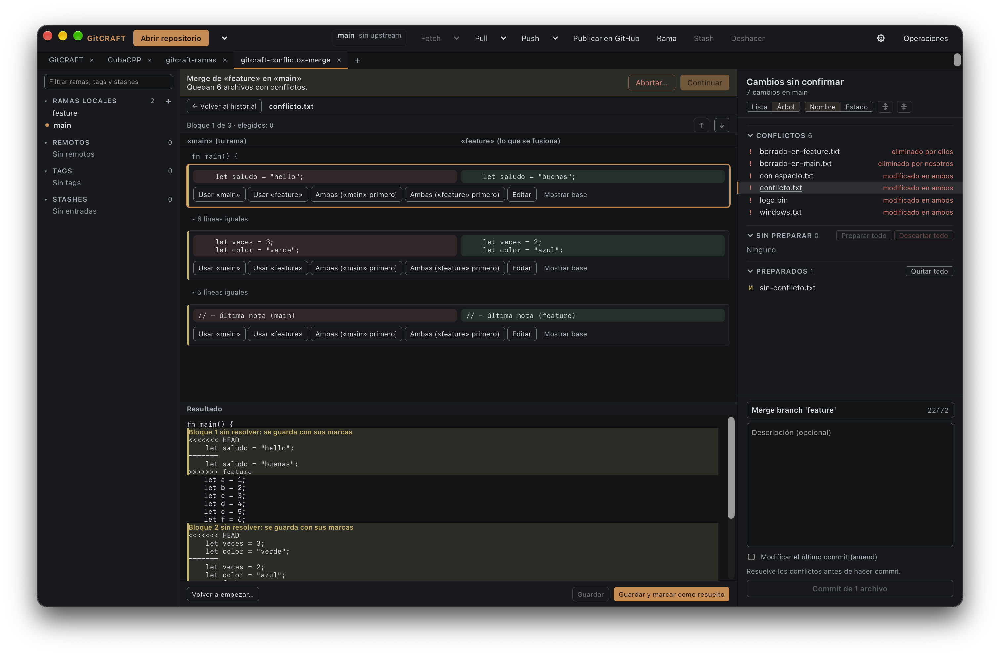
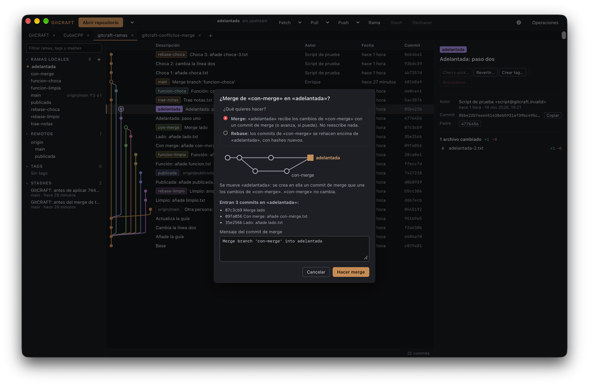

# GitCRAFT

🌐 [English](README.md) · **Español** · [العربية](README.md#in-other-languages) · [Deutsch](README.md#in-other-languages) · [Français](README.md#in-other-languages) · [Português](README.md#in-other-languages)

GitCRAFT – cliente Git visual, rápido y de código abierto

## En otros idiomas

<ul>
<li lang="en">English: GitCRAFT – a visual, fast, open-source Git client</li>
<li lang="es">Español: GitCRAFT – cliente Git visual, rápido y de código abierto</li>
<li lang="ar" dir="rtl">العربية: GitCRAFT – عميل Git مرئي وسريع ومفتوح المصدر</li>
<li lang="de">Deutsch: GitCRAFT – ein visueller, schneller Open-Source-Git-Client</li>
<li lang="fr">Français: GitCRAFT – un client Git visuel, rapide et open source</li>
<li lang="pt">Português: GitCRAFT – um cliente Git visual, rápido e de código aberto</li>
</ul>

> **Versión temprana (v0.3.0).** GitCRAFT se puede usar a diario para las
> funciones de abajo, pero es joven: puede tener asperezas y le faltan
> funciones (ver [lo que aún no hay](#lo-que-aún-no-hay)). Tus repositorios
> están a salvo: las operaciones destructivas siempre preguntan antes, y
> GitCRAFT usa tu propio `git`.

Hecho con Tauri 2, Rust, React y TypeScript. Licencia MIT.

GitCRAFT hace que el historial y las operaciones de Git se entiendan de un
vistazo y se ejecuten rápido, sin esconder lo que Git hace por debajo:

- **El grafo de commits es el centro**: carriles de color por rama, etiquetas
  de ramas, tags y HEAD, fluido con decenas de miles de commits.
- **Seguro por defecto**: toda operación destructiva pregunta antes y explica
  qué se pierde; los descartes se pueden deshacer.
- **Errores comprensibles**: los errores de Git se explican con palabras
  claras, y la salida original de Git está siempre a un clic.
- **Tu Git, tu configuración**: usa el binario `git` del sistema con tu
  configuración, hooks, credential helper y claves SSH. GitCRAFT nunca guarda
  credenciales.
- **Sin funciones de IA.**

## Capturas







## Qué funciona

- **Repositorios**: abrir, recientes, pestañas (reordenar, restaurar, atajos),
  una pestaña nueva (+ o ⌘T) con la página de inicio, inicializar, y clonar con
  progreso y cancelación.
- **Grafo de commits** para repositorios grandes, con el detalle de cada commit
  y sus diffs.
- **Cambios sin confirmar**: preparar y quitar archivos, hunks y líneas; vista
  de lista o de árbol de carpetas con navegación completa por teclado; preparar
  o quitar una carpeta entera; commit y amend; descartar con confirmación y
  deshacer.
- **Ramas**: crear, renombrar, borrar (listando los commits que se quedarían
  sin rama), checkout con «guardar en stash o cancelar»; filtro en la barra
  lateral.
- **Stash**: listar, crear, aplicar, pop, borrar con confirmación, recuperar un
  solo archivo.
- **Merge y rebase**: desde el menú de una rama o arrastrando una rama sobre
  otra, con una vista previa de lo que va a pasar (fast-forward, los commits
  que entran, los conflictos que tendría, los commits ya publicados) y el
  mensaje del merge editable; los cambios que estorban se pueden guardar antes
  y recuperar después, y el resultado se puede deshacer en el momento.
- **Conflictos**: una vista lado a lado para cada bloque en conflicto (lo tuyo,
  lo que llega y el resultado), elegir un lado, los dos o editar a mano; y
  después continuar, saltar o abortar el merge, rebase, cherry-pick o revert.
- **Acciones sobre un commit**: cherry-pick, revert y reset (soft, mixed o
  hard) desde el menú de un commit, con vista previa; el reset hard enumera lo
  que se perdería, guarda antes una copia recuperable y se puede deshacer en el
  momento.
- **Tags**: crear tags ligeros y anotados, subirlos, y borrarlos en local o en
  el remoto (con su propia confirmación).
- **Remotos**: fetch, pull (merge o rebase) y push con progreso y cancelación,
  indicadores de commits por delante y por detrás, push forzado solo con
  `--force-with-lease`; fetch automático opcional.
- **Ajustes** (⚙ o ⌘,): idioma, tamaño del texto, carpeta por defecto para
  clonar; rama por defecto y estrategia de pull de Git, y tu identidad de Git
  (global o por repositorio), mostrando siempre antes el comando `git config`
  exacto.
- **GitHub** mediante [GitHub CLI](https://cli.github.com) (`gh`): ver quién
  tiene la sesión iniciada, iniciar sesión dentro de la app, y publicar un
  repositorio local en tu cuenta (privado por defecto) tras un resumen de lo
  que se va a subir. GitCRAFT nunca guarda ni lee un token.
- **Errores claros y un panel de operaciones** con el historial exacto de los
  comandos `git` y `gh` que ha ejecutado (con las credenciales ocultas).
- Interfaz en español e inglés; una paleta oscura suave que cumple el
  contraste WCAG AA.

### Lo que aún no hay

Están previstos la búsqueda en el historial, el historial y blame de un
archivo, el rebase interactivo, deshacer cualquier operación reciente,
submódulos, worktrees, LFS y un tema claro. Las próximas fases
están en [docs/ROADMAP.md](docs/ROADMAP.md).

## Instalar

**De momento solo hay instalador para macOS** (Apple Silicon). Windows y Linux
están previstos: primero se está haciendo portable el código y después
llegarán sus instaladores.

1. Descarga `GitCRAFT_<versión>_aarch64.dmg` de
   [Releases](https://github.com/epmoreno/GitCRAFT/releases), o genéralo como
   se explica más abajo.
2. Ábrelo y arrastra GitCRAFT a Aplicaciones.
3. La primera vez, macOS avisa de que no puede verificar la app (ver abajo):
   pulsa **Aceptar** y luego **Ajustes del Sistema → Privacidad y seguridad →
   Abrir igualmente**.

Necesita Git instalado (Command Line Tools de Xcode o Homebrew). Las funciones
de GitHub (cuenta, publicar) necesitan GitHub CLI: `brew install gh`.

Probado en macOS 27.0.1; versiones anteriores no verificadas.

Instrucciones paso a paso y cómo desinstalar:
[docs/INSTALACION.md](docs/INSTALACION.md).

### ¿Por qué GitCRAFT no está firmado?

GitCRAFT es software libre y gratuito (licencia MIT): no se cobra nada por él.
Firmarlo y notarizarlo con Apple exige pagar una cuota anual del programa de
desarrolladores de Apple, y el proyecto ha decidido no hacerlo. Por eso macOS
muestra un aviso la primera vez que se abre. Ábrelo con **Ajustes del Sistema →
Privacidad y seguridad → Abrir igualmente**; no desactives nunca Gatekeeper.

Cómo comprobar la app tú mismo:

- **Checksum SHA-256**: las notas de cada Release incluyen el SHA-256 del
  `.dmg`. Compáralo con el de tu descarga:
  `shasum -a 256 ~/Downloads/GitCRAFT_<versión>_aarch64.dmg`
- **VirusTotal**: las notas de cada Release enlazan el análisis de ese mismo
  `.dmg` en VirusTotal; comprueba que el SHA-256 que muestra es el de tu
  archivo.
- **Compilarlo tú** desde el código con `npm run dist` (abajo). Un `.dmg`
  compilado por otra persona tiene otro SHA-256 (fechas de compilación y firma
  *ad-hoc*), así que compilar es una alternativa a descargar, no una forma de
  comprobar un archivo descargado.

## Compilar desde el código

Requisitos: macOS en Apple Silicon, Rust ≥ 1.90, Node ≥ 22, git ≥ 2.30.

```sh
npm install          # una vez
npm run tauri dev    # la app con recarga en caliente
npm run check        # formato + lint + tipos + todos los tests (web y Rust)
npm run dist         # genera GitCRAFT.app y el .dmg
```

`npm run dist` genera `target/release/bundle/macos/GitCRAFT.app` y
`target/release/bundle/dmg/GitCRAFT_<versión>_aarch64.dmg`.

Más sobre el proyecto: [docs/VISION.md](docs/VISION.md) (visión del producto) y
[docs/ARCHITECTURE.md](docs/ARCHITECTURE.md) (diseño).

## Licencia

[MIT](LICENSE). Avisos de terceros:
[THIRD_PARTY_NOTICES.md](THIRD_PARTY_NOTICES.md).
