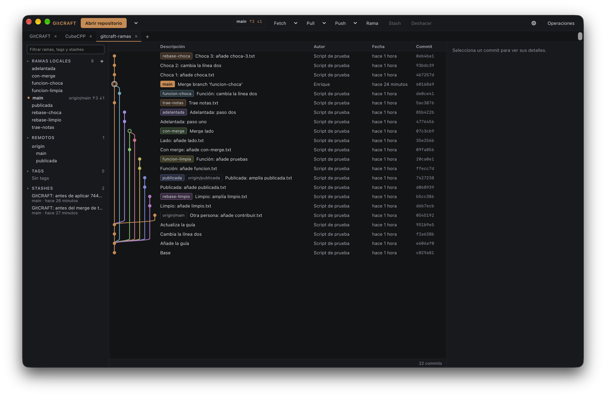
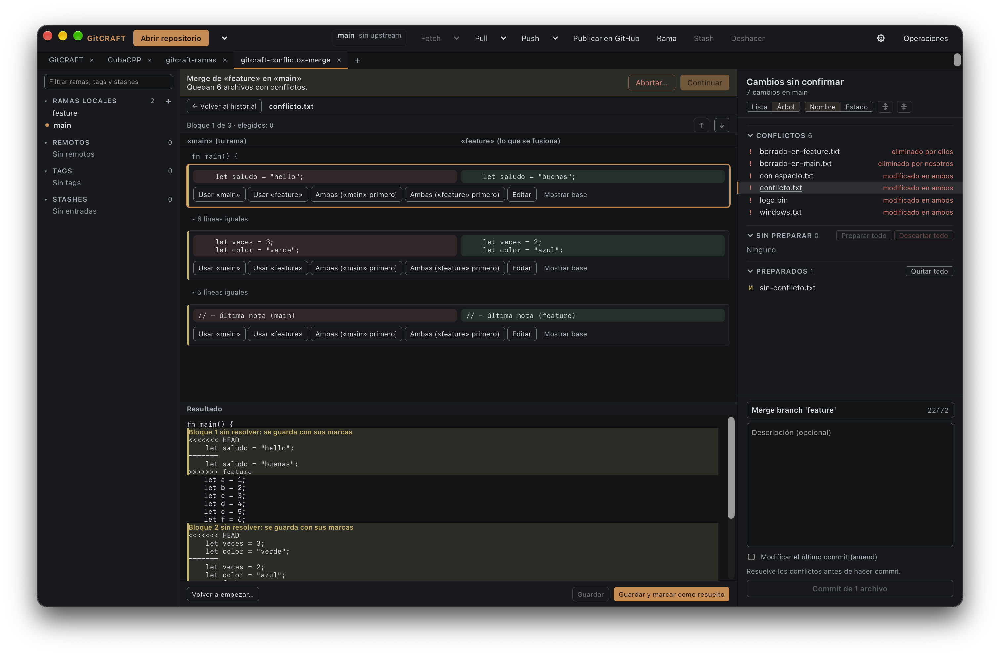
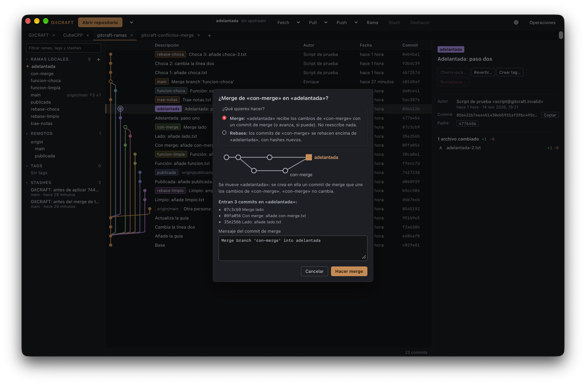

# GitCRAFT

🌐 **English** · [Español](README.es.md) · [العربية](#in-other-languages) · [Deutsch](#in-other-languages) · [Français](#in-other-languages) · [Português](#in-other-languages)

GitCRAFT – a visual, fast, open-source Git client

## In other languages

<ul>
<li lang="en">English: GitCRAFT – a visual, fast, open-source Git client</li>
<li lang="es">Español: GitCRAFT – cliente Git visual, rápido y de código abierto</li>
<li lang="ar" dir="rtl">العربية: GitCRAFT – عميل Git مرئي وسريع ومفتوح المصدر</li>
<li lang="de">Deutsch: GitCRAFT – ein visueller, schneller Open-Source-Git-Client</li>
<li lang="fr">Français: GitCRAFT – un client Git visuel, rapide et open source</li>
<li lang="pt">Português: GitCRAFT – um cliente Git visual, rápido e de código aberto</li>
</ul>

> **Early version (v0.3.0).** GitCRAFT is usable day to day for the features
> listed below, but it is young: expect rough edges and missing features (see
> [what is not there yet](#not-there-yet)). Your repositories are safe:
> destructive operations always ask first, and GitCRAFT runs your own `git`.

Built with Tauri 2, Rust, React and TypeScript. MIT licensed.

GitCRAFT makes Git's history and operations easy to read and quick to run,
without hiding what Git does underneath:

- **The commit graph is the centre**: colour lanes per branch, branch/tag/HEAD
  labels, smooth with tens of thousands of commits.
- **Safe by default**: every destructive operation asks first and explains
  what will be lost; discards can be undone.
- **Understandable errors**: Git's errors are explained in plain language, with
  Git's original output always one click away.
- **Your Git, your setup**: it runs the system `git` binary with your config,
  hooks, credential helper and SSH keys. GitCRAFT never stores credentials.
- **No AI features.**

## Screenshots

_The interface is shown in Spanish; it is also available in English._







## What works

- **Repositories**: open, recents, tabs (reorder, restore, shortcuts), a new
  tab (+ or ⌘T) with the start page, initialize, and clone with progress and
  cancellation.
- **Commit graph** for large repositories, with commit details and diffs.
- **Uncommitted changes**: stage and unstage files, hunks and lines; list or
  folder tree view with full keyboard navigation; stage or unstage a whole
  folder; commit and amend; discard with confirmation and undo.
- **Branches**: create, rename, delete (listing commits that would be left
  without a branch), checkout with stash-or-cancel; sidebar filter.
- **Stash**: list, create, apply, pop, drop with confirmation, recover a
  single file.
- **Merge and rebase**: from a branch's menu or by dragging one branch onto
  another, with a preview of what will happen first (fast-forward, the
  commits that come in, conflicts it would have, commits already published)
  and an editable merge message; changes in the way can be saved first and
  recovered later, and the result can be undone right away.
- **Conflicts**: a side-by-side view for each conflicting block (yours, theirs
  and the result), choose either side, both or edit by hand; then continue,
  skip or abort the merge, rebase, cherry-pick or revert.
- **Commit actions**: cherry-pick, revert and reset (soft, mixed or hard)
  from a commit's menu, with a preview; a hard reset lists what would be lost,
  keeps a recoverable copy first and can be undone right away.
- **Tags**: create lightweight and annotated tags, push them, and delete them
  locally or on the remote (with its own confirmation).
- **Remotes**: fetch, pull (merge or rebase) and push with progress and
  cancel, ahead/behind indicators, forced push only with
  `--force-with-lease`; optional automatic fetch.
- **Settings** (⚙ or ⌘,): language, text size, default clone folder; Git's
  default branch and pull strategy and your Git identity (global or per
  repository), always showing the exact `git config` command first.
- **GitHub** through [GitHub CLI](https://cli.github.com) (`gh`): see who is
  signed in, sign in inside the app, and publish a local repository in your
  account (private by default) after a summary of what will be uploaded.
  GitCRAFT never stores or reads a token.
- **Clear errors and an operations panel** with the exact history of the `git`
  and `gh` commands it ran (credentials redacted).
- Spanish and English UI; a softer dark palette that meets WCAG AA contrast.

### Not there yet

History search, file history and blame, interactive rebase, undoing any
recent operation, submodules, worktrees, LFS and a light theme are planned. The next phases are in
[docs/ROADMAP.md](docs/ROADMAP.md) (in Spanish).

## Install

**For now there is only an installer for macOS** (Apple Silicon). Windows and
Linux are planned: the code is being made portable first, then their
installers.

1. Download `GitCRAFT_<version>_aarch64.dmg` from
   [Releases](https://github.com/epmoreno/GitCRAFT/releases), or build it as
   explained below.
2. Open it and drag GitCRAFT to Applications.
3. The first time, macOS warns that it cannot verify the app (see below):
   press **OK**, then **System Settings → Privacy & Security → Open Anyway**.

It needs Git installed (Xcode Command Line Tools or Homebrew). GitHub features
(account, publishing) need GitHub CLI: `brew install gh`.

Tested on macOS 27.0.1; earlier versions are not verified.

Step-by-step instructions and how to uninstall:
[docs/INSTALL.md](docs/INSTALL.md).

### Why isn't GitCRAFT signed?

GitCRAFT is free, open-source software (MIT license): nothing is charged for
it. Signing and notarizing it with Apple requires a paid yearly Apple
Developer Program membership, and the project has chosen not to pay it. That
is why macOS shows a warning the first time you open it. Open it with
**System Settings → Privacy & Security → Open Anyway**; never disable
Gatekeeper.

How to check the app yourself:

- **SHA-256 checksum**: every Release's notes include the `.dmg`'s SHA-256.
  Compare it with your download's:
  `shasum -a 256 ~/Downloads/GitCRAFT_<version>_aarch64.dmg`
- **VirusTotal**: every Release's notes link to VirusTotal's analysis of that
  same `.dmg`; check that the SHA-256 it shows is your file's.
- **Build it yourself** from source with `npm run dist` (below). A `.dmg`
  built by someone else has a different SHA-256 (build dates and an ad-hoc
  signature), so building is an alternative to downloading, not a way to
  check a downloaded file.

## Build from source

Requirements: macOS on Apple Silicon, Rust ≥ 1.90, Node ≥ 22, git ≥ 2.30.

```sh
npm install          # once
npm run tauri dev    # run the app with hot reload
npm run check        # format + lint + typecheck + all tests (web and Rust)
npm run dist         # build GitCRAFT.app and the .dmg
```

`npm run dist` writes `target/release/bundle/macos/GitCRAFT.app` and
`target/release/bundle/dmg/GitCRAFT_<version>_aarch64.dmg`.

More about the project: [docs/VISION.md](docs/VISION.md) (product vision) and
[docs/ARCHITECTURE.md](docs/ARCHITECTURE.md) (design), in Spanish.

## License

[MIT](LICENSE). Third-party notices:
[THIRD_PARTY_NOTICES.md](THIRD_PARTY_NOTICES.md).
